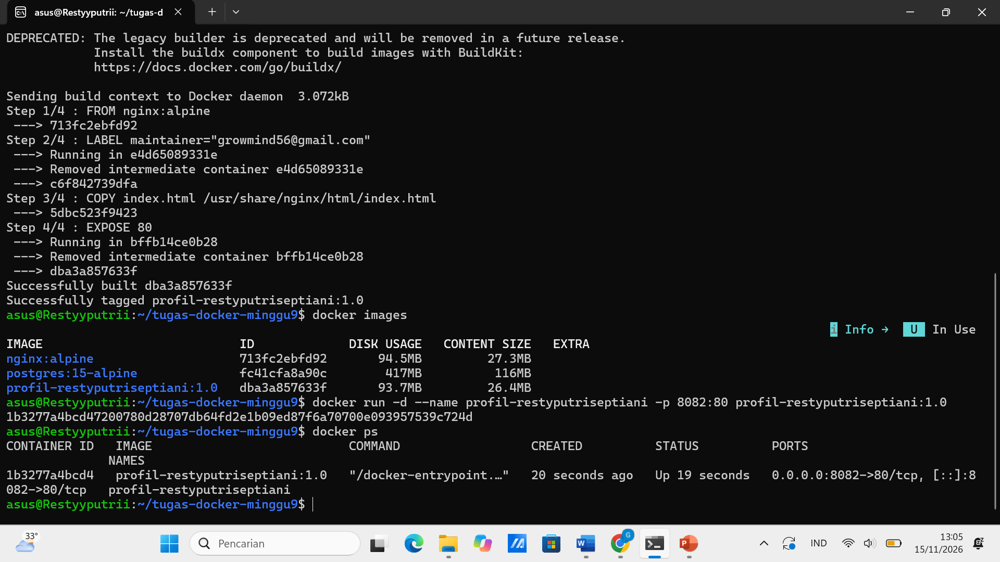

# Tugas Docker Minggu 9: Kontainerisasi Halaman Profil

Halaman profil sederhana yang dijalankan dengan Docker (nginx:alpine).

## Cara Build
docker build -t profil-restyputriseptiani:1.0 .

## Cara Run
docker run -d --name profil-restyputriseptiani -p 8082:80 profil-restyputriseptiani:1.0

Lalu buka http://localhost:8082 di browser.

## Screenshot

