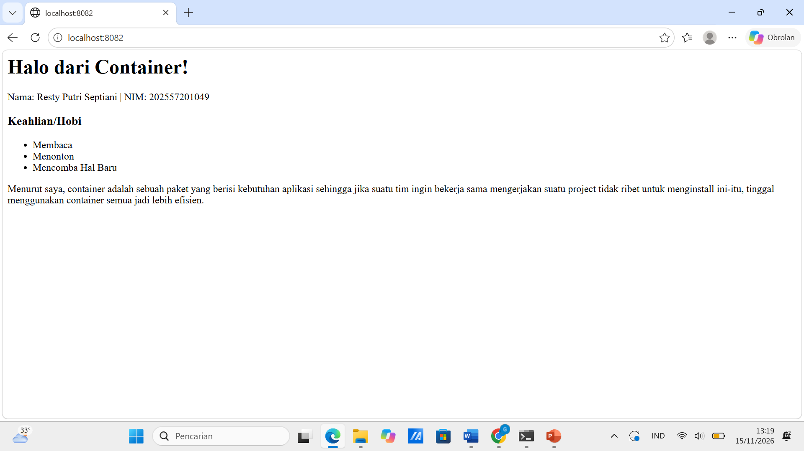
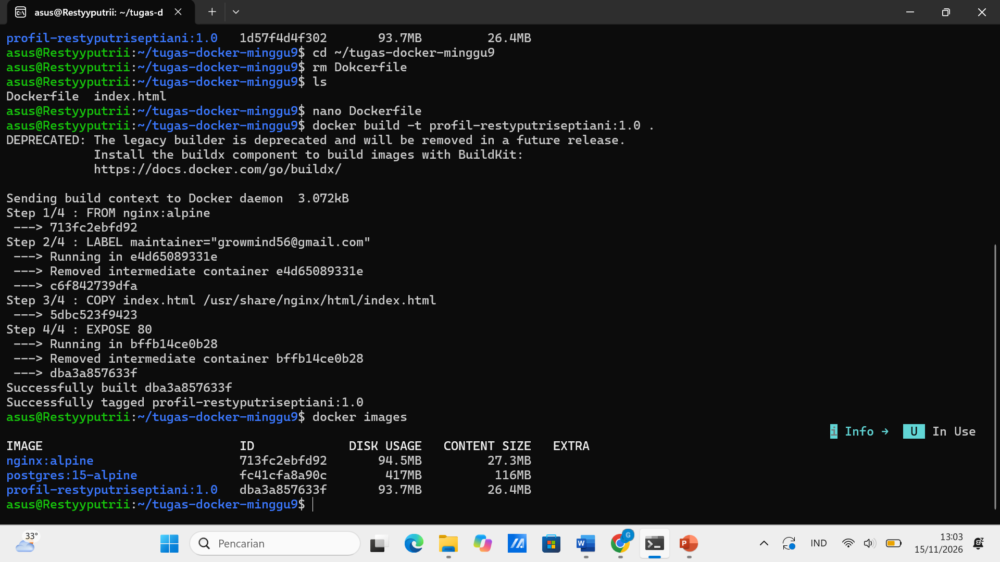

# Tugas Docker Minggu 9: Kontainerisasi Halaman Profil

Proyek ini berisi halaman profil sederhana yang dibungkus dengan Docker menggunakan image dasar nginx:alpine, lalu dijalankan sebagai container.

##Nama:** Resty Putri Septiani
##NIM:** 202557201049
##Mata kuliah:** Teknologi Open Source (Minggu 9: Pengenalan Containerization)

## Isi Repositori
- `Dockerfile`: resep untuk membuat image
- `index.html`: halaman profil yang ditampilkan
- `gambar1.png`, `gambar2.png`, `gambar3.png`: screenshot hasil pengerjaan

## Prasyarat
Docker sudah terpasang di komputer.

## Cara Build
docker build -t profil-restyputriseptiani:1.0 .

## Cara Run
docker run -d --name profil-restyputriseptiani -p 8082:80 profil-restyputriseptiani:1.0

Lalu buka http://localhost:8082 di browser.

## Cara Menghentikan dan Membersihkan
docker stop profil-restyputriseptiani
docker rm profil-restyputriseptiani
docker rmi profil-restyputriseptiani:1.0

## Docker Hub
Image juga tersedia di Docker Hub: https://hub.docker.com/r/restyputri/profil-restyputriseptiani

## Screenshot
Halaman profil di browser:

Hasil docker ps:

Hasil docker images:

